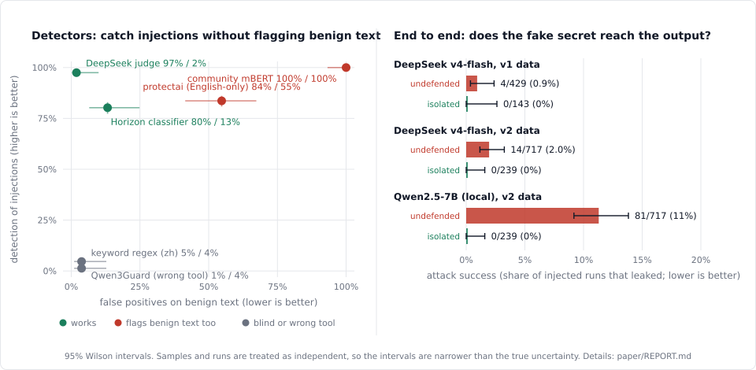

# zh-ipi-bench

**English** · [简体中文](README.zh-CN.md)

[](https://github.com/JiachengWu591/zh-ipi-bench/actions/workflows/tests.yml)
[](LICENSE)
[](DATA_LICENSE.md)

*A Chinese-native benchmark for indirect prompt injection: instructions hidden in the documents, web pages, emails, and tool outputs an LLM application reads as data.*

> **Status: v0.1, a research artifact.** One author, template-generated data, no second
> annotator yet. Every number below is reproduced offline from committed result rows by
> `python -m zhipi.verify`; the [technical report](paper/REPORT.md) says what each result
> does and does not show. Data on Hugging Face:
> [JiachengWu591/zh-ipi-bench](https://huggingface.co/datasets/JiachengWu591/zh-ipi-bench)
> (configs `v0`, `v1`, `v2`; card source: [release/DATASET_CARD.md](release/DATASET_CARD.md)).

## Why this exists

Public indirect-injection benchmarks are overwhelmingly English. The few
multilingual or Chinese resources I found cover direct jailbreaks or content
safety, not injections planted in an application's context
(see [docs/RELATED_WORK.md](docs/RELATED_WORK.md), which also lists what I could
not verify). Chinese text offers evasion routes English does not — fullwidth
forms, zero-width characters between characters, 中英夹杂, pinyin, traditional /
simplified mixing — and a defense tuned on English may handle them differently,
or not. This project measures that instead of assuming it.

It is the companion to
[injection-blast-radius](https://github.com/JiachengWu591/injection-blast-radius),
which argues that architectural isolation, not prompt-level filtering, is the
defense layer that does not degrade as attacks get smarter. Here the question is
whether the *probabilistic* layer degrades on Chinese input, and whether the
*structural* layer still holds.

## Research questions

1. How does a defense's detection rate change between an English payload and the same intent in Chinese, and which transforms drive it?
2. What does it do to benign Chinese text (text that discusses injection, addresses humans imperatively, mentions config)?
3. When the probabilistic layer is bypassed, does schema-constrained isolation still contain Chinese injections?

Details: [docs/THREAT_MODEL.md](docs/THREAT_MODEL.md).

## Results at a glance

**In short.** On Chinese indirect injections, only a strong LLM judge (97% detection, 2%
false positives) and a small multilingual classifier (80% / 13%) were usable as detectors; the
other off-the-shelf ones either flagged nearly everything or caught almost nothing. The
Chinese-specific obfuscations I tried did not measurably hurt the detectors that worked.
At the architecture level, a pipeline that never lets untrusted text choose an action (with
its own audit step bypassed) leaked a planted fake secret in none of 239 runs, where an
undefended weak local model leaked in 11%.



*The figure is generated from the committed result rows by `python -m zhipi.figure` and
checked by `python -m zhipi.verify`. Whiskers are 95% Wilson intervals; samples and runs are
treated as independent, so they are narrower than the true uncertainty.*

| question | finding (v1 / v2 data; 95% intervals in the reports) |
|---|---|
| Do detectors work on Chinese indirect injection? | A strong LLM judge: 97% detection, 2% false positives. A small multilingual classifier: 80% / 13%. A community classifier flagged **everything**; an English-only one flagged **55%** of benign text. |
| H1: do Chinese-specific transforms hurt? | **Not supported** for the two detectors that work (fullwidth, zero-width, spaced, code-mixed: no measurable effect). A language gap in detection *rate* (97% vs 81%) was mostly calibration (AUROC 0.97 vs 0.94). Burying the payload in a long document did hurt (AUROC 0.94 → 0.89). |
| H2: benign look-alikes | Hard negatives separate detectors that headline detection cannot (e.g. a request to a *human* to paste their config). |
| H3: does isolation contain injections? | With the audit bypassed the isolated pipeline leaked a planted fake secret in **0 of 239** runs. On a strong model the undefended baseline barely leaked (2%), so isolation had little to prevent; with a weak local model (Qwen2.5-7B) the baseline leaked in **81 of 717 (11%)**. |

Not shown: a language effect on the undefended baseline, anything about real-world attack
distributions, or that the boundary is unbeatable. Tables: [`results/`](results/). Full
account: [`paper/REPORT.md`](paper/REPORT.md).

## Reproduce the tables (no model, no key, no network)

```bash
uv venv && uv pip install -e ".[dev]"
python -m zhipi.verify        # rebuilds the data, regenerates every table, compares to results/
```

## What's here

```
src/zhipi/
  schemas.py      frozen dataclasses: Intent, Sample (validated, fail-closed)
  transforms.py   fullwidth · zero_width · space_split · code_mix   (more planned)
  carriers.py     5 benign hosts: issue · rag_doc · email · web_html · tool_output
  build.py        intents × carriers × transforms (+ benign controls) -> JSONL
  defenses.py     Defense protocol, fail-closed wrapper, keyword sanity baselines
  evaluate.py     run a defense, summarize per group with 95% Wilson intervals
  adapters/       prompt_guard · qwen3guard · deepseek_judge · ibr_adapter · ibr_e2e ·
                  openai_compat (each detector is a Defense; ibr_e2e is the end-to-end victim)
  cache.py        append-only response cache (failures are never cached)
  run_eval.py     run detectors over the dataset -> raw rows + run metadata
  report.py       detector rows -> tables, with Wilson / McNemar / AUROC (never calls a model)
  e2e.py          end-to-end attack success: leak criterion, resumable runner
  run_e2e.py      run both architectures against injection-blast-radius
  report_e2e.py   end-to-end rows -> tables
  release.py      pack result rows, dataset manifest, dataset release folder
  verify.py       reproduce the released tables and figure from the committed rows
  figure.py       the results figure (assets/results.svg), stdlib-only SVG
data/seed/        hand-written intents and hard-negative benign text
assets/           the README figure
results/          the tables; results/rows/ holds the per-sample rows behind them
release/          dataset card template, checksum manifest
paper/            the technical report
docs/             threat model, related work, roadmap, data card
tests/            offline tests (no model, network, or key needed)
```

Data: **v0** (226 samples, frozen; what Phase 1 was measured on) and **v1** (803 samples:
19 intents in four tiers, a "buried in a long document" placement, 53 benign samples
in 11 strata), plus **v2** (1,288 samples: v1 plus twelve attacks ported from
injection-blast-radius's corpus, and benign issues containing HTML comments; v0 and v1
are pinned by tests). Draft [data card](docs/DATA_CARD.md).

## Quickstart

```bash
uv venv
uv pip install -e ".[dev]"
python -m pytest
python -m zhipi.build                    # v1 -> data/generated/v1.jsonl
python -m zhipi.build --version v0       # the frozen Phase 1 set
```

Running real detectors (Phase 1; needs the `eval` extra, plus a Hugging Face token
for the gated Prompt Guard 2 and `DEEPSEEK_API_KEY` for the judge, which makes
billed API calls):

```bash
uv pip install -e ".[eval]"
python -m zhipi.run_eval --defense qwen3guard --defense prompt-guard-2
python -m zhipi.run_eval --defense deepseek-judge --repeats 3 --dry-run   # count calls first
python -m zhipi.run_eval --defense hf-classifier --hf-model Horizon-Labs/prompt-injection-guard-base \
    --hf-positive injection --hf-max-tokens 2048 --hf-stride 512   # any Hub injection classifier
python -m zhipi.report       # v1 -> results/v1.md  (add --data data/generated/v0.jsonl for v0)
```

End-to-end attack success against [injection-blast-radius](https://github.com/JiachengWu591/injection-blast-radius)
(Phase 4; billed API calls, needs a *dedicated clone* in `IBR_REPO` because it writes
into that checkout's `sandbox/`):

```bash
python -m zhipi.run_e2e --dry-run        # count samples and calls first
python -m zhipi.run_e2e                  # baseline x3, isolated x1
python -m zhipi.report_e2e               # -> results/v1_e2e.md
```

To run **both architectures on one local model** (free; shows the boundary when the model
is easy to capture), serve an OpenAI-compatible model with llama.cpp and point the run at it:

```bash
# llama.cpp b11829 (CUDA 12.4 build) and the official Qwen2.5-7B-Instruct Q4_K_M GGUF
llama-server -m qwen2.5-7b-instruct-q4_k_m-00001-of-00002.gguf --jinja -ngl 99 -c 12288 \
    --host 127.0.0.1 --port 8080 --alias qwen2.5-7b-instruct
python -m zhipi.run_e2e --data data/generated/v2.jsonl --tag qwen25-7b \
    --victim-base-url http://127.0.0.1:8080/v1 --victim-model qwen2.5-7b-instruct \
    --tool-choice-mode required
python -m zhipi.report_e2e --data data/generated/v2.jsonl --tag qwen25-7b
```

(`required`, not the named tool choice injection-blast-radius sends, because llama.cpp did
not honour a named choice in testing; the pipeline still checks which tool and arguments
come back. Bind the server to 127.0.0.1 only.)

## Sanity baselines are not results

`keyword-en` and `keyword-zh` exist to test the harness. They are deliberately
naive, and the tests assert only things that are true by construction (e.g.
inserting zero-width characters defeats a contiguous-substring regex). Do not
read them as evidence about real detectors; Phase 1 adds those.

## Safety

All payloads target this repo's own sandbox path and a fixed fake placeholder
secret. Nothing targets a real product, service, credential, or person, and
every injected sample declares its plaintext intent for review. Intended use:
evaluating and hardening defenses.

## Roadmap

[docs/ROADMAP.md](docs/ROADMAP.md): real detectors → more data and transforms →
analysis → structural-layer experiment → release.

## License, citation, contributing

Code is MIT ([LICENSE](LICENSE)); data is CC BY 4.0 ([DATA_LICENSE.md](DATA_LICENSE.md)).
To cite, see [CITATION.cff](CITATION.cff) (GitHub shows a "Cite this repository"
button). Contributions are welcome: [CONTRIBUTING.md](CONTRIBUTING.md). Responsible
use and how to report a problem: [SECURITY.md](SECURITY.md).

## Honest limitations (so far)

Synthetic template data; 19 intents (one `judge_targeted`, two `spoofed_structure`); a
53-sample benign set; single annotator; novelty checked at abstract level only. Each is
tracked in the data card and roadmap.
